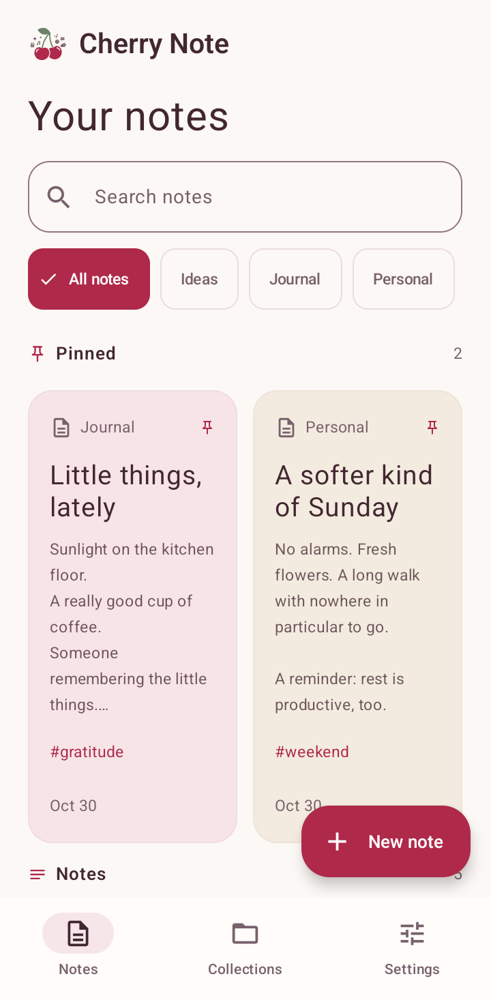
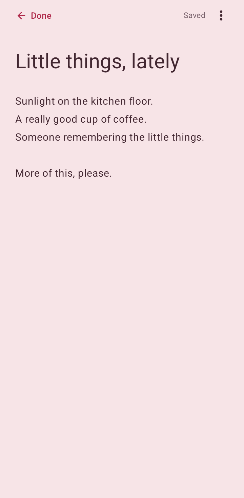
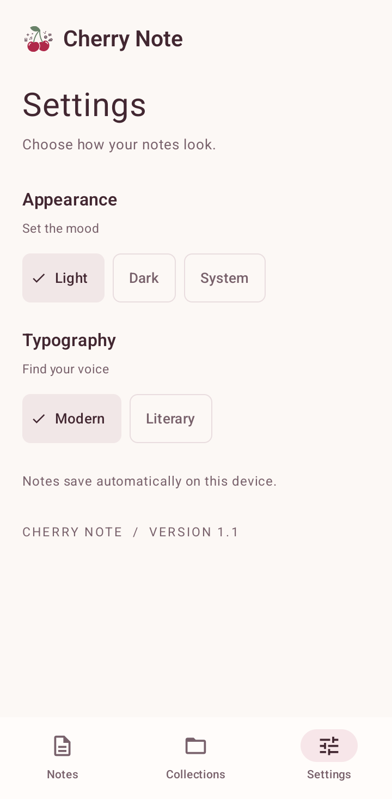

<div align="center">
  
  <h1>Cherry Note</h1>
  <p><strong>A calm little home for your thoughts.</strong></p>
  <p>An offline Android notebook for quick thoughts, checklists, and collections.</p>
  <p>
    
    
    
  </p>
  <p>
    <a href="#screenshots">Screenshots</a> ·
    <a href="#features">Features</a> ·
    <a href="#getting-started">Get started</a> ·
    <a href="https://github.com/asta-JC/Cherry-Note/issues">Feedback</a>
  </p>
</div>

---

## Overview

Cherry Note keeps everyday writing close at hand. Search your notebook, open a thought, and keep writing while changes save automatically. Collections, pinned notes, and five soft note colors help you find your place, with warm cream or plum surfaces and the shared CherryApps header mark.

## Screenshots

<table>
  <tr><th width="33%">Your notes</th><th width="33%">Room to write</th><th width="33%">Make it yours</th></tr>
  <tr>
    <td align="center"></td>
    <td align="center"></td>
    <td align="center"></td>
  </tr>
  <tr><td align="center">Search, filter, and pin.</td><td align="center">Write with automatic saving.</td><td align="center">Choose your theme and reading font.</td></tr>
</table>

Captured from v1.1 on a physical Samsung Galaxy S22 Ultra (SM-S908N), all in Light mode. Notes are the app's built-in demonstration data. Personal system bars are cropped; app content is unchanged.

## Features

- **Write and save:** edit titles and note bodies with automatic local saving; add tags or bold text in Note options.
- **Find a thought:** search titles, content, and tags; filter by collection and keep pinned notes first.
- **Keep a checklist:** add, edit, complete, and remove individual checklist items.
- **Organize collections:** choose a collection name, symbol, and color, then create notes directly inside it.
- **Make it comfortable:** choose System, Light, or Dark appearance, Modern or Literary reading typography, and five note colors. Larger text uses wider note columns.
- **Keep writing offline:** notes and collections live in Room; appearance choices are remembered in DataStore. No account or internet permission is required.

## Compatibility

| Area | Support and limits |
| :--- | :--- |
| Platform | Android 7.0 / API 24 and newer; targets API 37 |
| Storage | Local notes and collections; no cloud sync or file import/export UI |
| Backups | Android backup follows device policy; uninstalling or clearing storage removes local data unless restored by Android backup |
| Earlier builds | A one-time compatibility import recovers active notes and collections from the earlier experimental database |
| Deletion | Delete note permanently removes the note after confirmation |

## Getting started

### Requirements

- Android 7.0 / API 24 or newer on a physical device.
- Android Studio compatible with the pinned Gradle and Android Gradle Plugin versions.
- Android SDK 37 and JDK 25, as requested by the Gradle daemon toolchain. The project targets Java 11 bytecode.

### Build and run

```bash
git clone https://github.com/asta-JC/Cherry-Note.git
cd Cherry-Note
./gradlew :app:assembleDebug
```

The APK is generated at `app/build/outputs/apk/debug/app-debug.apk`. Run the app from Android Studio on your physical device, or install without clearing its data:

```bash
adb -s YOUR_DEVICE_SERIAL install -r app/build/outputs/apk/debug/app-debug.apk
```

### Tests

```bash
./gradlew :app:testDebugUnitTest :app:lintDebug
./gradlew :app:assembleDebugAndroidTest
adb -s YOUR_DEVICE_SERIAL install -r app/build/outputs/apk/androidTest/debug/app-debug-androidTest.apk
adb -s YOUR_DEVICE_SERIAL shell am instrument -w \
  com.asta.cherry_note.test/androidx.test.runner.AndroidJUnitRunner
```

Install the app APK first. Unit tests cover search and note colors; the physical-device test creates, edits, reopens, and deletes notes in its own temporary database.

## Built with

| Layer | Technology |
| :--- | :--- |
| Interface | Kotlin, Jetpack Compose, Material 3, native vector branding |
| Navigation | Navigation Compose |
| Local data | Room and Preferences DataStore |
| State and concurrency | ViewModel, lifecycle-aware StateFlow, Kotlin coroutines |
| Build | Gradle Kotlin DSL, version catalog, KSP |
| Checks | JUnit, AndroidX Test, Android Lint |

## What's new in 1.1

- Full CherryApps logo in theme-aware headers, with updated adaptive and monochrome launcher icons.
- Consistent cherry, cream, and plum colors across controls, sheets, and dialogs.
- Clearer app typography, readable card details, and layouts that adapt to larger text.
- Restored navigation state and background search filtering that keeps input independent from results.

## Feedback

[Open an issue](https://github.com/asta-JC/Cherry-Note/issues) with your device model, Android and app versions, and steps to reproduce. Use non-sensitive sample notes and screenshots.

## License & credits

This project is developed as part of Asta's project series. Feel free to use and adapt for personal and educational use!

The repository does not include a standalone license file. Third-party libraries retain their respective licenses. App artwork and CherryApps branding are by Asta.

---

<p align="center">
  <strong>Made with ❤️ &amp; 🍒 by Asta</strong><br />
  <sub>Part of the CherryApp family.</sub>
</p>
